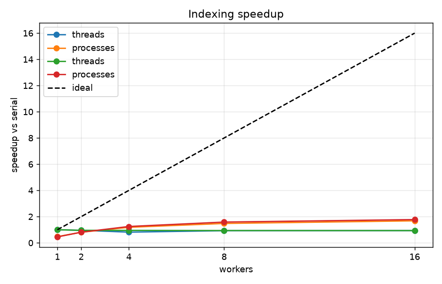

[](https://github.com/Kondelyar/findex/actions/workflows/ci.yml)

# findex

Full-text search engine, built incrementally over the Python course labs.

## Corpus

The engine processes documents in `.jsonl` format (one JSON object per line). Each line has at least an `id` and an `abstract` field:

```json
{"id": "2101.00001", "abstract": "We propose a new method for ..."}
```

Note: while the primary target structure is the Cornell arXiv dataset, the pipeline works with any valid .jsonl file. For the benchmarks below, a real text corpus (Alice's Adventures in Wonderland) was converted into 2595 JSONL documents and saved as `data/arxiv.jsonl` (see `convert_to_jsonl.py`).

While developing without a real corpus, `scripts/make_sample_corpus.py` generates a small synthetic `.jsonl` corpus with the same shape, so the pipeline can be tested end to end:

```bash
uv run python scripts/make_sample_corpus.py data/sample.jsonl --docs 5000
```

## Setup

```bash
uv sync
```

## Lab 1 — corpus intake

```bash
uv run python -m findex.stats data/arxiv.jsonl
uv run python -m findex.stats data/arxiv.jsonl --limit 1000   # first N docs only
```

Prints document count, token count, vocabulary size, top-50 terms, elapsed time
and peak memory (measured with `tracemalloc`).

### Tokenizer policy

- Unicode-aware: `\w`-based, so Cyrillic and accented Latin letters count as
  letters, not just ASCII.
- `unicodedata.normalize("NFC", ...)` runs before anything else, so a
  precomposed character (`é`) and a decomposed one (`e` + combining accent)
  produce the same token.
- `str.casefold()`, not `.lower()` — the stricter form intended for
  case-insensitive comparison.
- Digits break a token: `python3` -> `python`.
- A hyphen breaks a token: `well-known` -> `well`, `known`.
- An apostrophe (`'` or `’`) inside a word keeps it together: `don't`, `п'ять`.

See `tests/test_tokenize.py` for the exact cases this is checked against.

### Eager vs. lazy (M4)

Measured with `scripts/compare_eager_lazy.py` on the real 2595-document corpus (Alice's Adventures in Wonderland):

| version           | documents | peak memory | elapsed  |
|:-----------------|:---------:|:-----------:|:--------:|
| eager (lists)     | 2595      | 2.38 MB     | 0.058s   |
| lazy (generators) | 2595      | 0.18 MB     | 0.047s   |

The eager version reads every document into a list, then builds a list of
token lists for all of them, before counting anything — at its peak it is
holding the full corpus text and the full tokenized corpus in memory at the
same time. The lazy version never holds more than the current document and
its tokens; the only thing that legitimately grows is the `Counter` that
holds the final term counts, which is unavoidable — that's the answer we
actually need.

## Lab 2 — inverted index

### Build and save

```bash
uv run python -m findex.index data/arxiv.jsonl --out data/index.pkl
uv run python -m findex.index data/arxiv.jsonl --out data/index.json   # second format, by extension
```

Builds `postings: dict[str, list[Posting]]`, `doc_lengths` and `doc_meta` in one
streaming pass over the Lab 1 pipeline, and saves the result. Prints document
count, term count, elapsed time and peak memory.

### Boolean engines

`search.py` still contains the Lab 2 engines: `evaluate(index, query, engine="merge" | "set")`.
Terms separated by spaces are implicit `AND`; `AND`, `OR`, `NOT` (uppercase only, so
a lowercase `and` is an ordinary word) are evaluated strictly left to right.
`merge` walks the sorted postings lists with two pointers; `set` uses Python's
built-in set operations on the same doc_ids. The command line now uses the Lab 3
ranked search (below).

### merge vs. set benchmark (M2)

Measured with `scripts/compare_engines.py` on `data/arxiv.jsonl`:

```bash
uv run python scripts/compare_engines.py data/arxiv.jsonl
```

| query | engine | avg time |
|---|---|---|
| common AND (and AND the) | merge | 0.0245 ms |
| common AND (and AND the) | set | 0.0510 ms |
| rare AND (title AND author) | merge | 0.0023 ms |
| rare AND (title AND author) | set | 0.0024 ms |


### Persistence

`store.py` supports two formats:

- **pickle** (`.pkl`) — serializes the `Posting`/`DocMeta`/`Index` objects directly.
  Fast, but `pickle.load` runs arbitrary code embedded in the file — only ever
  load a pickle findex itself produced, never one from an untrusted source.
- **json** (`.json`) — safe, human-readable, slightly bigger and slower, since
  every dataclass instance becomes a plain `dict` on the way out and back.

### Postings memory study (M4)

Measured with `scripts/posting_memory_study.py` on `data/arxiv.jsonl` — same
postings, three different representations, each saved and reloaded with pickle:

```bash
uv run python scripts/posting_memory_study.py data/arxiv.jsonl --tmp data/posting_variant.pkl
```

| representation | peak memory (build) | index file size | load time |
|---|---|---|---|
| list[Posting], plain dataclass | 3.23 MB | 551.7 KB | 22.26 ms |
| list[Posting], slots=True | 2.16 MB | 633.1 KB | 20.54 ms |
| array('I') pairs | 1.28 MB | 346.7 KB | 12.15 ms |

## Lab 3 — ranking and the object model

### Index as an object

`Index` (in `models.py`) subclasses `collections.abc.Mapping`, so it speaks the
container protocol: `len(index)` is the number of terms, `"alice" in index`,
`index["alice"]` (postings, `KeyError` if absent), `for term in index`, and a
readable `repr`. It also exposes `num_docs`, `avg_doc_length` (a `cached_property`,
computed once), `doc_length(doc_id)` and `df(term)`. `open_index(path)` in
`store.py` is a context manager that loads the index and calls `index.close()`
on exit, also when the body raises.

Phrase queries need token positions, so the index has to be built with a flag
(it makes the index bigger):

```bash
uv run python -m findex.index data/arxiv.jsonl --out data/index.pkl --positions
```

Indexes built before Lab 3 have no `positions` field and must be rebuilt.

### Query language

```
or_expr  := and_expr ('OR' and_expr)*
and_expr := not_expr (['AND'] not_expr)*      # a missing AND is implicit
not_expr := 'NOT' not_expr | atom
atom     := term | "quoted phrase" | '(' or_expr ')'
```

`query.py` is a small recursive-descent parser that builds a tree of frozen
dataclasses (`Term`, `Phrase`, `And`, `Or`, `Not`). The nodes overload `&`, `|`
and `~`, and each has `evaluate(index) -> set[int]`, so
`parse('a OR b c') == Or(Term('a'), And(Term('b'), Term('c')))` — `AND` binds
tighter than `OR`. Phrases are matched through positions: a phrase matches a
document if some start position `p` has the next word at `p + 1`, and so on.

### Ranking

`scoring.py` defines a `Scorer` protocol, `score(term, posting, index) -> float`,
with two implementations that can be swapped freely:

- `TfIdf`: `(1 + ln tf) * ln(N / df)`
- `BM25(k1=1.5, b=0.75)`: `idf * tf * (k1 + 1) / (tf + k1 * (1 - b + b * len / avg_len))`,
  with `idf = ln(1 + (N - df + 0.5) / (df + 0.5))`

`Searcher.search(query, scorer=BM25(), k=10)` evaluates the query tree to get the
matching documents, adds up the scorer's weight for every positive term (terms
under `NOT` don't score), and takes the top `k` with `heapq.nlargest`.

```bash
uv run python -m findex.search data/index.pkl "white rabbit"
uv run python -m findex.search data/index.pkl "(alice OR queen) NOT rabbit" --scorer tfidf
uv run python -m findex.search data/index.pkl "\"tea party\"" --limit 5
```

### Ranking sanity checks (M2)

```bash
uv run python scripts/ranking_sanity.py data/index.pkl
```

```
1. rare vs common term, same document (doc 1676, tf=1)
   tfidf  'title' (df=1) = 7.861
   tfidf  'the' (df=1372) = 0.637
   bm25   'title' (df=1) = 7.261
   bm25   'the' (df=1372) = 0.621

2. repeating 'the' in doc 1676
   tf=1   tfidf=0.637  bm25=0.621
   tf=2   tfidf=1.079  bm25=0.893
   tf=5   tfidf=1.663  bm25=1.213
   tf=10  tfidf=2.105  bm25=1.377
   tf=20  tfidf=2.547  bm25=1.478
   tf=21  tfidf=2.578  bm25=1.483

3. one match of 'the': shortest vs longest document
   tfidf  doc 153 (0 tokens) = 0.637  |  doc 1535 (18 tokens) = 0.637
   bm25   doc 153 (0 tokens) = 1.159  |  doc 1535 (18 tokens) = 0.504
```


### Timing and caching (M4)

`@timed` (in `timing.py`, uses `functools.wraps`) logs elapsed milliseconds for
`build_index`, `load_pickle` / `load_json` and `Searcher.search`. The query →
matching doc_ids path is wrapped in `functools.lru_cache(maxsize=256)`. The cache is
created per `Searcher` instance (the `Index` is a mutable mapping and not hashable, so
it cannot be part of a cache key) and stores a tuple, not a set, so callers can't
change a cached result.

```bash
uv run python -m findex.search data/index.pkl "white rabbit" --repeat 2 -v
```

```
load_pickle took 136.15 ms
search took 0.56 ms
search took 0.37 ms
query:    white rabbit
scorer:   BM25(k1=1.5, b=0.75)
matches:  22
elapsed:  0.138s
peak mem: 10.04 MB
cache:    CacheInfo(hits=2, misses=1, maxsize=256, currsize=1)
```

### Snippets

For every result the CLI re-reads the document text from the corpus file stored
in `DocMeta.path`, finds the window of ±80 characters with the most matched
words, and highlights them with `**`. It needs the corpus file at the path it
was indexed from.

```
query:    white rabbit
scorer:   BM25(k1=1.5, b=0.75)
matches:  22
elapsed:  0.145s
peak mem: 10.04 MB

[doc_2201] 9.706
    These were the verses the **White** **Rabbit** read:—
[doc_228] 8.534
    **Rabbit** returning, splendidly dressed, with a pair of **white** kid gloves
[doc_234] 8.534
    sir—” The **Rabbit** started violently, dropped the **white** kid gloves and
[doc_508] 8.534
    It was the **White** **Rabbit**, trotting slowly back again, and looking
[doc_1980] 8.534
    stopped hastily, for the **White** **Rabbit** cried out, “Silence in the
```

### precision@5 (M4)

Ten queries in `eval/queries.json`, with hand-labelled relevant document ids
(`doc_N` from `data/arxiv.jsonl`). `--show` prints the top 5 results to help with labelling.

```bash
uv run python scripts/precision_at_5.py data/index.pkl eval/queries.json --show
uv run python scripts/precision_at_5.py data/index.pkl eval/queries.json
```

| query | TF-IDF P@5 | BM25 P@5 |
|---|---|---|
| white rabbit | 0.6 | 1.0 |
| cheshire cat | 1.0 | 1.0 |
| queen OR croquet | 0.8 | 1.0 |
| hatter OR dormouse | 0.8 | 1.0 |
| caterpillar | 0.4 | 1.0 |
| "tea party" | 0.4 | 0.4 |
| "mock turtle" | 0.2 | 1.0 |
| pool OR tears | 0.6 | 1.0 |
| golden key | 0.8 | 0.8 |
| (alice OR queen) NOT rabbit | 1.0 | 1.0 |
| **mean** | 0.66 | 0.92 |

## Lab 4 — a real tool

### Install

```bash
uv sync                  # development environment
uv tool install .        # puts `findex` on your PATH
uv build                 # dist/findex-0.4.0-py3-none-any.whl + sdist
```

From a release (no clone needed):

```bash
uv tool install https://github.com/Kondelyar/findex/releases/download/v0.4.0/findex-0.4.0-py3-none-any.whl
findex --help
```

### Usage

```bash
findex index data/arxiv.jsonl --out data/index.pkl --positions   # progress bar on stderr
findex index data/arxiv.jsonl --out data/index.json --limit 500  # json format, first 500 docs
findex search data/index.pkl "white rabbit" --k 5                # ranked table with snippets
findex search data/index.pkl "(alice OR queen) NOT rabbit" --scorer tfidf
findex search data/index.pkl '"tea party"' --json | jq .id       # JSON lines on stdout
findex stats data/index.pkl --top 20
findex -vv search data/index.pkl "rabbit"                        # logs on stderr
```
```text
┏━━━┳━━━━━━━━━━┳━━━━━━━┳━━━━━━━━━━━━━━━━━━━━━━━━━━━━━━━━━━━━━━━━━━━━━━━┓
┃ # ┃ id       ┃ score ┃ snippet                                       ┃
┡━━━╇━━━━━━━━━━╇━━━━━━━╇━━━━━━━━━━━━━━━━━━━━━━━━━━━━━━━━━━━━━━━━━━━━━━━┩
│ 1 │ doc_18   │ 5.048 │ CHAPTER I. Down the Rabbit-Hole               │
│ 2 │ doc_49   │ 5.048 │ large rabbit-hole under the hedge.            │
│ 3 │ doc_507  │ 4.806 │ The Rabbit Sends in a Little Bill             │
│ 4 │ doc_2201 │ 4.586 │ These were the verses the White Rabbit read:— │
│ 5 │ doc_21   │ 4.385 │ CHAPTER IV. The Rabbit Sends in a Little Bill │
└───┴──────────┴───────┴───────────────────────────────────────────────┘
                         48 matches, showing 5  
```

Data (the table, the JSON lines) goes to stdout and everything diagnostic (logs, the
progress bar, error messages) goes to stderr, so `--json` output can be piped safely.
An expected error (missing file, bad query, phrase query on an index built without
`--positions`) prints one `error: ...` line and exits with code 1, never a traceback.
`-v` sets the log level to INFO and `-vv` to DEBUG; logging is configured only in
`cli.py`, every other module just does `log = logging.getLogger(__name__)`.

### Typing

`pyright` runs in strict mode over `src/` (configured in `pyproject.toml`).
`Scorer` is a `typing.Protocol`, the `@timed` decorator is generic over its signature
with PEP 695 syntax (`def timed[**P, R](fn: Callable[P, R]) -> Callable[P, R]`),
`evaluate` takes `Literal["merge", "set"]`, and `Node` is an abstract base class so the
checker knows every query node has `evaluate` and `positive_terms`. There is no
`# type: ignore` anywhere.

```bash
uv run pyright
```

```
0 errors, 0 warnings, 0 informations
```

### Tests

```bash
uv run pytest                      # everything
uv run pytest -m "not slow"        # skip the end-to-end test on a 4000-document corpus
uv run pytest --cov=findex --cov-report=term-missing
```

```
 116 passed in 5.98s 
```

Hypothesis properties (`tests/test_properties.py`):

| property | what it checks |
|---|---|
| tokens are never empty, tokenizing is idempotent | `tokenize(" ".join(tokenize(t))) == tokenize(t)` for any Unicode text |
| merge agrees with sets | `merge_and/or/not` equal the set operations on any two sorted id lists |
| postings are sorted | for any list of documents, every postings list is ordered by doc_id |
| save/load round trip | pickle and json both give back the same postings, lengths and metadata |
| parser inverts renderer | `parse(render(tree)) == tree` for randomly generated query trees |

Coverage: **99%**. The lines that are not covered are the `main()` of
`stats.py` (the old Lab 1 argparse entry point, replaced by `findex stats`; its `run()`
is tested) and the `case _` branch of `render()`, a defensive error for node types
that don't exist.

### CI and release

`.github/workflows/ci.yml` runs `ruff check`, `ruff format --check`, `pyright` and
`pytest --cov` on every push and pull request (the badge at the top shows the result).

```bash
git tag v0.4.0 && git push --tags
gh release create v0.4.0 dist/findex-0.4.0-py3-none-any.whl --title v0.4.0 --notes "Lab 4: typed, tested, packaged CLI"
```

Release: https://github.com/Kondelyar/findex/releases/tag/v0.4.0

## Lab 5 — concurrency and the GIL

### Parallel indexing

The corpus is one big `.jsonl` file, so a "chunk" is a slice of a file: a byte range that starts
and ends on a line boundary (`corpus.plan_chunks`). Every chunk also knows the number of its
first line, and a document's `doc_id` is now its line number in the corpus, so the doc_id
ranges of different chunks are fixed up front and never overlap. (`Document.line` is new; a
missing `id` falls back to `file@byte-offset` instead of `file:line`.)

- `build_partial(chunk)` builds an `Index` over one chunk (a module-level function, so it can be pickled).
- `merge(partials)` appends the postings of consecutive partials, which keeps them sorted.
- `run_chunks(chunks, workers, executor)` runs `build_partial` in a plain loop, in a
  `ThreadPoolExecutor` or in a `ProcessPoolExecutor`; the same code for all three.
  A worker exception is re-raised in the parent, it does not hang.

```bash
findex index data/big.jsonl -o data/index.pkl --executor processes --workers 8
findex index data/big.jsonl -o data/index.pkl --executor threads --workers 8
findex index data/big.jsonl -o data/index.pkl            # default, see below
```

Default: `processes` with `os.cpu_count()` workers when the corpus is at least 4 MB, otherwise
`serial`, because starting processes costs more than indexing a small corpus. An explicit
`--executor` is always respected. `--limit` only works with the serial path.
The launch code is spawn-safe: nothing starts a pool at import time. If `findex.exe` misbehaves
with processes on Windows, `python -m findex index ...` does the same thing.

Tests (`tests/test_parallel.py`): chunks cover every document exactly once for 1…50 parts;
a Hypothesis property says merged partials equal the serial index for any corpus and any number
of chunks; serial, threads and processes (started with `spawn`) save **byte-identical** JSON indexes;
a failing worker raises `FileNotFoundError` in every executor.

### What it took for processes to pay off

The first version of the process executor was ~2x **slower** than serial even on a big corpus.
`scripts/pickle_tax.py` shows why: every partial index has to be pickled in the worker and
unpickled by the parent, one after another.

```bash
uv run python scripts/pickle_tax.py data/big.jsonl
```

```
build_partial: 6.86s, 5,561,000 postings

| pickled as | dumps (s) | loads (s) | size (MB) |
|---|---|---|---|
| default dataclass | 8.63 | 5.56 | 94.2 |
| Posting.__reduce__ | 4.27 | 1.71 | 73.0 |

(both measured with the garbage collector paused, as findex runs;
 loading the __reduce__ blob with it on takes 10.29s instead of 1.71s)

the parent unpickles every partial sequentially: 1.71s of 6.86s serial work
so Amdahl caps the speedup at about 4.0x, however many workers
```

Two fixes, both measured:

1. `Posting.__reduce__` / `DocMeta.__reduce__`: the default pickling of a slotted dataclass is
   several times slower than rebuilding the object from its fields.
2. The cycle garbage collector is paused while the index is built (`gc_paused` in the parent,
   `initializer=gc.disable` in every worker). Building creates millions of objects that never
   become garbage, and the collector keeps rescanning them.

`merge` itself is almost free (doc_ids were assigned up front); the sequential part of the
process version is unpickling the partials in the parent, and it is hidden inside the `map` time.

### Benchmark

Machine: *(CPU model, cores, RAM, OS; laptop plugged in, other programs closed)*

The real corpus is small, so it was scaled up by repeating it (the vocabulary stays the same):

```bash
uv sync --group bench
uv run python scripts/scale_corpus.py data/arxiv.jsonl data/big.jsonl --copies 200
uv run python scripts/bench_parallel.py data/big.jsonl --out bench/gil.json
```

Free-threaded build (separate environment, **without** the dev group: `hypothesis` has no
free-threaded build):

```bash
uv python install 3.13t
set UV_PROJECT_ENVIRONMENT=.venv-313t      # PowerShell: $env:UV_PROJECT_ENVIRONMENT = ".venv-313t"
uv run --python 3.13t --no-dev python scripts/bench_parallel.py data/big.jsonl --out bench/nogil.json --executors threads
uv run --group bench python scripts/bench_report.py bench/gil.json bench/nogil.json --png docs/speedup.png
```

Every measurement is a fresh subprocess (3 runs, median; one discarded warm-up run first).
Wall time is `perf_counter`; CPU time is the parent's `process_time` plus the children's
(`RUSAGE_CHILDREN` on Linux/macOS; on Windows what each worker reports when its last task ends,
so pickling the result is not included); peak RSS is the parent's. Speedup is always against
the serial row of the normal build.

| Executor | Workers | Wall (s) | CPU (s) | Peak RSS (MB) | Merge (s) | Speedup |
|---|---|---|---|---|---|---|
| *(paste the table from bench_report.py)* | | | | | | |



### The GIL in numbers

`scripts/gil_demo.py`, run on the normal build and on 3.13t: four CPU timings, a data race, and
threads on real (loopback socket) I/O.

```
(paste the output on the normal build)
```

```
(paste the output on 3.13t)
```

### Explanation

*(Rewrite this in your own words and fill in the numbers.)*

**Why threads did not scale.** The GIL lets only one thread run Python bytecode at a time; it
exists because CPython counts references and two threads changing a count at once would corrupt
it. Indexing is CPU-bound (tokenizing, building dicts and Posting objects), so with `<N>` threads
the speedup was `<x>`: they took turns, and the switching added a little overhead. The GIL is
released while waiting on I/O, which is why the same threads do scale on the request benchmark
in `gil_demo.py` (`<t1>` s with 1 thread, `<t30>` s with 30).

**Why processes did, and what they cost.** Every process has its own interpreter and its own
GIL, so the workers really run in parallel: `<x>`x at `<N>` workers. The price is visible in the
table: CPU time is `<a>` s against `<b>` s serial, and the parent's peak RSS is `<c>` MB. The
extra CPU is startup plus pickling the partial indexes (`pickle_tax.py`: `<d>` s to unpickle
`<e>` postings) and the memory is the partials held in the parent next to the merged index.
That is why a worker gets a *range of a file* and not the documents, and returns a compact result.

**Amdahl.** The sequential part is planning the chunks, unpickling the partials in the parent and
the merge: `<f>` s of `<g>` s serial work, i.e. a fraction of `<p>`. The speedup can never be
more than 1/p = `<m>`x; the measured curve flattens at `<k>` workers.

**Free-threaded build.** With the GIL off, the same `ThreadPoolExecutor` code reached `<x>`x at
`<N>` threads (CPU time is now about workers x wall time, as it should be). `findex` itself
exposed no race, because workers share nothing: each builds its own private partial index and
only the parent merges. The hazard is still real, and `gil_demo.py` shows it: two threads doing
`shared += 1` a million times each always end at 2000000 on the normal build, but on 3.13t they
lose updates (`<n>` instead of 2000000) until a `Lock` is added. The normal interpreter only
switches threads at a few points (function calls and loop jumps), so the GIL was hiding the bug;
the code was never correct, it just never failed.
